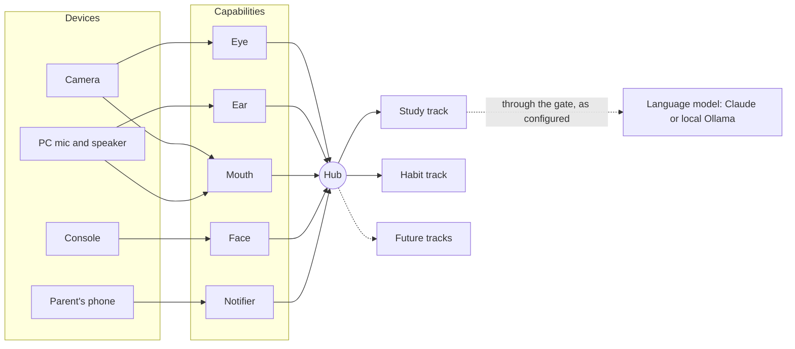

# 🍃 Leafi

Leafi uses AI and common household devices to solve the many small problems of daily life: a child practising reading aloud, a habit that needs a reminder, a break after long study, a stuffy room that needs fresh air. It runs on what a home typically has — a camera, a PC, a phone, a sensor — and lets each household choose what stays at home.

We deploy AI tools on these devices, test them in a real home, write down what worked, and share it, so that each new household need starts from what others have already learned.

## What it does

**Working now**

- **Reading practice.** A child reads a paper book aloud. Leafi follows along against the page text, waits until the child has finished, then practises the words that went wrong and explains what was not understood. New words go to Anki for review. When Leafi misreads the page, the child can correct it, and Leafi keeps the correction.
- **Daily habits.** At set times Leafi gives a reminder through the camera's speaker, checks on the local machine that the task happened (presence, pose, how long), and tells a parent's phone.

**Next**

- A reminder to take a break or change posture after long sitting.
- An air-quality sensor that suggests opening a window.
- An old phone or a small ESP32 box as another camera, microphone or screen.
- Describing a new helper in plain words, and Leafi putting it together from the devices it has.

## Design

Three ideas make one system serve many needs:

- **Hardware is configuration.** A device is not tied to one feature. It offers **capabilities** — Eye (sees), Ear (listens), Mouth (speaks), Face (shows text), Notifier (sends a message) — and each use, a **track**, asks the Hub for what it needs. The same reading session runs on a camera, on a PC microphone, or as typed text with no hardware. Adding a device means one adapter and one entry in [`config/devices.yml`](config/devices.yml).
- **AI is swappable.** Each AI job (OCR, speech recognition, voice, pronunciation, language) sits behind one interface, so its backend can be replaced without touching the uses. Today: RapidOCR, Parakeet and Silero, Kokoro, OpenPronounce on the local machine; Claude or a local Ollama model for language.
- **Local first, cloud by choice.** Sensing runs at home by default. Each cloud service is a household setting, and all of them go through one gate.



## Privacy you configure

Each household decides what may leave the home. The defaults keep sensing local, and every cloud service is a switch the family turns on, in `.env` or on the settings page:

| Choice | Default | Options |
|---|---|---|
| Language model | none until a key or a local model is set | a cloud model (Claude), a local model (Ollama), or both with a fallback |
| Voice for spoken lines | English local (Kokoro); Chinese a cloud voice (edge-tts) | local or cloud for each language |
| Names in text sent to the cloud | replaced, by the household's own list and a name detector | extend the list; turn the detector off |
| A camera frame in the parent's notification | off | on |
| Keeping audio clips | off | on |
| Book lookup, notifications, health heartbeat | off until set | each its own service and key |

Whatever is chosen, it all goes through one gate in the code, `leafi.privacy.egress`, which applies the household's settings, sends only to listed services, and logs every request. Recognising *who* someone is is never part of a vision check, and cameras stay out of the bathroom. Every setting: [`docs/architecture/quality-attributes/security.md`](docs/architecture/quality-attributes/security.md).

## How tools are tested and shared

Every tool and device is measured at home before a design relies on it, and the results stay in the repository:

- [`docs/research/`](docs/research/): tools compared and tried, with versions and dates — for example, a local trial of OCR evaluation tools (MLflow, Phoenix, Langfuse, FiftyOne).
- [`docs/hardware/`](docs/hardware/): what each device really does: microphone quality, speaker delay, failure modes.
- [`docs/adr/`](docs/adr/): the decisions made and why.

## Try it

A typed reading session on a sample page — no camera, no microphone, nothing spoken (Windows, Python 3.12 via `uv`):

```powershell
uv venv --python 3.12 .venv
uv pip install --python .venv -r requirements.txt -r requirements-study.txt
.venv\Scripts\python -m leafi study --text --mock --book "Fixture" --page-text tests/fixtures/pages/p1.txt --page 1
```

Cameras, voice, the habit track and the parent's tools: [`docs/getting-started.md`](docs/getting-started.md).

## Roadmap

- **Now:** a reading session led by the AI; several children with separate records; the privacy gate ([active plan](docs/plans/active/2026-10-22-ai-led-study.md)).
- **Next:** the camera as the main eye and ear; habits on the same Hub; break and air-quality helpers.
- **Later:** phones and ESP32 boxes as devices; helpers described in plain words; recipes that one household can share with another.

## Taking part

Everyone is welcome: share a household need, a tool worth trying, a measurement from your own devices, or code. The repository is written so that AI coding agents can work on it too; start with [`AGENTS.md`](AGENTS.md) and [`GLOSSARY.md`](GLOSSARY.md).

## License

Leafi is open source under the [GNU Affero General Public License v3.0](LICENSE), with additional terms in [`NOTICE`](NOTICE):

- **Share alike.** Whoever distributes Leafi or a modified version, or offers it to others over a network, must publish the complete source under the same license.
- **No impersonation.** The name "Leafi" and its authors' names are not licensed. A modified version must carry a different name or be clearly marked as modified, may not claim to be the original or to be endorsed by its authors, and keeps the notice "Based on Leafi".

Third-party components and downloaded models keep their own licenses.
