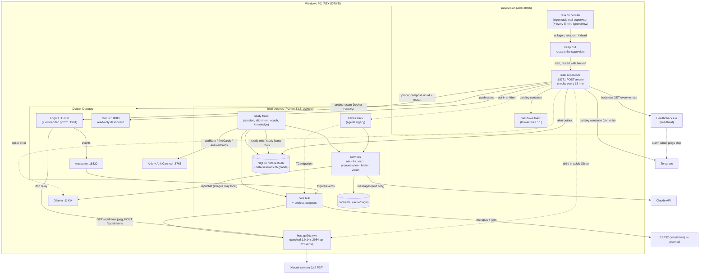

# C4 L2 — containers

Port roster (host): go2rtc api 2984 / rtsp 2554, Frigate 15000, MQTT 18830, Ollama 11434, AnkiConnect 8765, task editor 8770, supervisor rearm 18771, Gatus 18080 (loopback), xiaozhi ws 8800 (planned).

The supervision layer's state machine and alert path are drawn in `flows/supervision.md`; ADR-0016 owns its rules.
