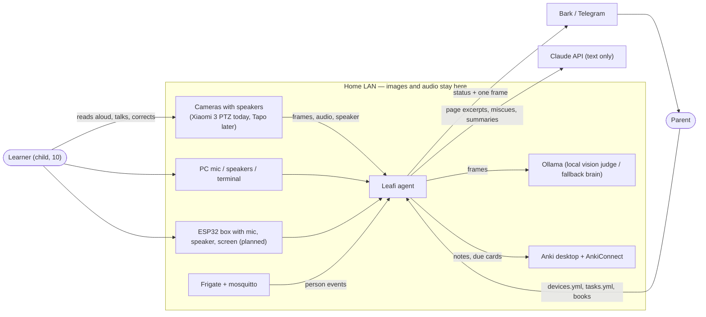

# C4 L1 — system context

Mermaid is this repository's renderer (GitHub and Obsidian preview); see `engineering/conventions.md`.

Trust boundary: everything inside `LAN` may see pixels and audio. The two arrows that cross out carry text only (Claude) or text plus a single parent-addressed snapshot (push). The Xiaomi camera itself needs internet once per connection to fetch P2P keys from Xiaomi cloud; that traffic carries no media.
