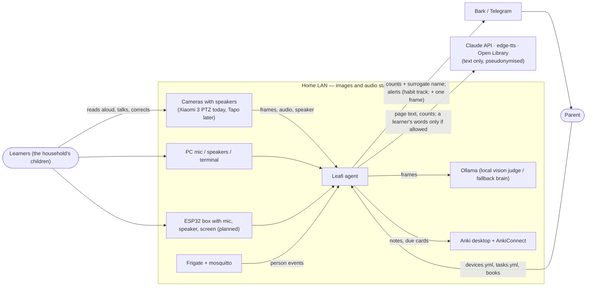

# C4 L1 — system context

Mermaid is this repository's renderer (GitHub and Obsidian preview); see `engineering/conventions.md`.

Trust boundary: everything inside `LAN` may see pixels and audio. Every arrow that crosses out leaves through `leafi.privacy.egress` (ADR-0018): text only, every household name, school and listed term replaced, a learner's words redacted like any text (ADR-0021: by content, never by source); the socket guard refuses any other connection. The habit track's push may add a single parent-addressed snapshot (`NOTIFY_WITH_SNAPSHOT`, ADR-0011). The Xiaomi camera itself needs internet once per connection to fetch P2P keys from Xiaomi cloud; that traffic carries no media.
