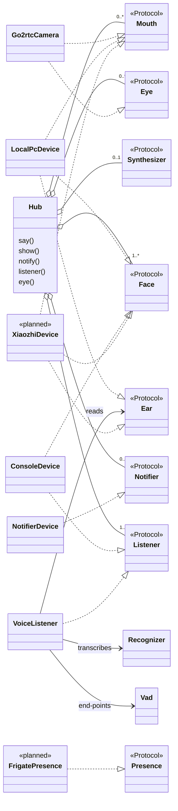
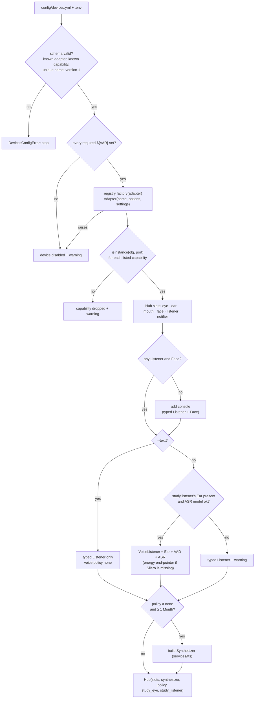

# Device ports and adapters

How Leafi stays hardware-agnostic (ADR-0002). Port signatures live in `leafi/core/ports.py`, the adapter registry in `leafi/devices/__init__.py`, the build in `leafi/app.py`; this page only draws them. The runtime path of one spoken line is in [`flows/device-routing.md`](flows/device-routing.md).

## Which adapter provides which port

- An adapter may implement more ports than `config/devices.yml` assigns it; the `capabilities` list decides which Hub slots it fills.
- `VoiceListener`, `Vad` and `Recognizer` live in `leafi/services/asr/`; any Ear can feed a `VoiceListener`, so a new microphone needs no Listener code.
- Multiplicities are what the Hub accepts: zero Mouths is valid (text on Faces only); a Listener and a Face always exist because the console is added when none is configured.
- Not drawn: the go2rtc camera's Ear (opt-in once measured, `docs/hardware/`) and the Wyoming adapter (ADR-0008).

## How the Hub is built at startup

- Only schema errors stop startup; a missing variable, a failing constructor or a false capability claim costs one device or one slot, with a warning `python -m leafi devices` prints.
- Adapters have no import-time side effects, so a dead device fails in its constructor, inside the `try` that disables it.
- Adding hardware = one adapter module, one line in `ADAPTERS`, one `devices.yml` entry, and a measurement before a design relies on it (`docs/hardware/README.md`).
