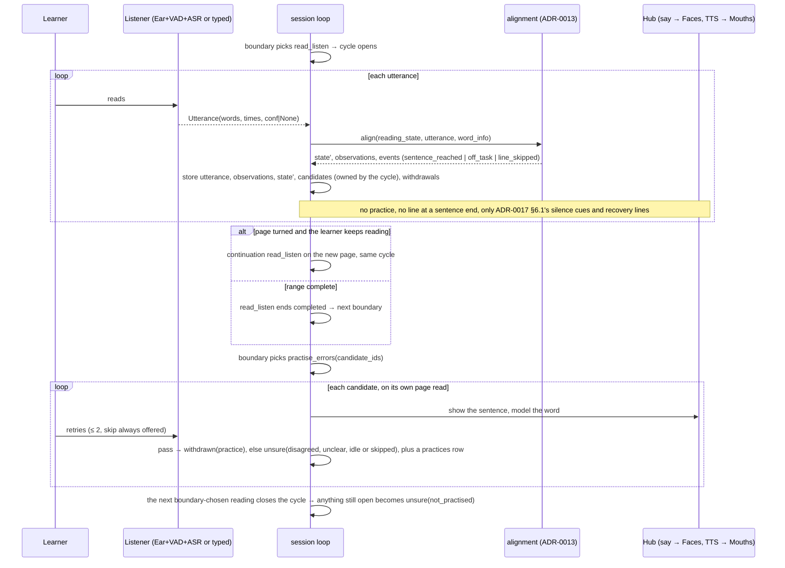

# Flow: a study session

The session is a sequence of activities chosen at boundaries (ADR-0017); this file draws it and adds nothing. **The session loop, menu, negotiation, construction, deadlines, controls and records are owned by ADR-0017; the reading rules (alignment, completion, cycles and candidates, practice, `/back`, Difficulties, CHECK outcomes) by ADR-0013; who is studying, guests and egress by ADR-0018.** Page identity and revisions: ADR-0010.

Status: ADR-0017 and ADR-0018 are accepted, ADR-0013 v2 is proposed, and the code still runs the v1 state machine in `leafi/study/session.py` (READ → PRACTICE at a sentence end → CHECK) until plan [`../../plans/active/2026-10-22-ai-led-study.md`](../../plans/active/2026-10-22-ai-led-study.md) replaces it.

## The session loop

```mermaid
stateDiagram-v2
    [*] --> START: lease acquired
    START --> IDENTIFY: stale sessions closed, guests swept (ADR-0017 §2)
    IDENTIFY --> BOOK: learner adopted, or guest (ADR-0018 §1)
    BOOK --> BOUNDARY: book identified; arm assigned (ADR-0017 §9)
    BOUNDARY --> NEGOTIATE: menu, observation, sequencer's proposal
    NEGOTIATE --> BOUNDARY: Reobserve (epoch changed)
    NEGOTIATE --> ACTIVITY: accepted, announced or named (autonomy bands)
    NEGOTIATE --> FINALIZE: end
    ACTIVITY --> ACTIVITY: page_turned and still reading → continuation (same cycle)
    ACTIVITY --> BOUNDARY: completed / skipped / page_turned / aborted_stale / store_busy
    ACTIVITY --> FINALIZE: terminal (stop, lease lost, deadline, idle, listener lost, internal error)
    BOUNDARY --> FINALIZE: soft deadline reached
    FINALIZE --> DELIVER: one local transaction (cycle closed, summary, guest end state)
    DELIVER --> NOTES: closing line, Anki outbox (10 s)
    NOTES --> [*]: post-session learner notes (20 s, not for guests); lease released
```

Activities (ADR-0017 §3.1): `review_anki`, `read_listen`, `read_aloud`, `practise_errors`, `teach_items`, `recall_items`, `quiz`, `learner_questions`, `add_cards`, `break`, `end`. With no Brain, or in the `default` arm, the configurable default policy picks the next step (review → recall → practise → teach → cards → read → end).

**Global controls** (ADR-0017 §1): `stop` sets the session's terminal latch and cancels whatever runs; `skip` is consumed once by the running activity or the current negotiation; `/back N`, page turns and `next page` act inside `read_listen` (ADR-0013 → Control precedence). The soft deadline stops new activities; the hard deadline cuts the running one.

## Reading and practising one cycle



The Brain is never between the end of an utterance and Leafi's first reaction (ADR-0017 §5.2): fillers, recovery lines and closing lines are static phrases; a late Brain result is dropped when the epoch has moved on.

## Handling a correction (B5)

1. Utterance classified as `correction` (grammar: "the book says X not Y" / "it's X not Y" / typed `/fix Y X`); ambiguous cases ask once ("Do you mean the word is X?").
2. Locate `old_text` in the current revision near the cursor (nearest occurrence within the reread window); if not found, ask the learner to point at the line (read it) and retry once; else give up politely and record a `corrections` row with `char_start = null`.
3. One transaction (ADR-0010 §3, §6): correction row (with the learner who made it, ADR-0018 §3); new revision with the span verified and the edit map; `spans_verified` and the reading state transformed (ADR-0013 → Correction interaction); miscues of any revision whose mapped char span overlaps → `invalidated (page_text_corrected)`, leaving the cycle's open set; Difficulties recomputed; lexicon update.
4. The reading state now points at the new revision; the learner continues from the committed cursor; Leafi thanks them in the Coach voice.

## Questions and explanations (B6)

A learner's "what does … mean" or "I don't understand" during reading is answered by the `learner_questions` activity at the next boundary, or by `teach_items` when the item is a new-item candidate of the cycle (ADR-0017 §3.1). Both record a knowledge item and an encounter.

## Comprehension (B7)

The `quiz` activity asks ≤ `quiz.max_questions` per cycle over the cycle's read sentences; construction rejects a question its cited sentences do not support; a spoken answer counts only when confidently recognised (ADR-0017 §3.4); counted answers are scored by ADR-0013 → CHECK outcomes; only `incorrect` writes an encounter. Page text and learner text are data inside delimited blocks, and every Brain output is validated against its schema (`security.md` → Prompt safety).

## Wrap

`finalize` (one local transaction): close the running activity and the open cycle, write the summary counts, set `ended_at`, apply the guest end state. `deliver`: closing line while the speech lease is held; Anki outbox processed (dedupe by `leafi-id::<key>`, add/update, ack; failures stay `pending`). `extract_notes`: learner notes with citations, skipped for guests. The lease is released whatever happened.
