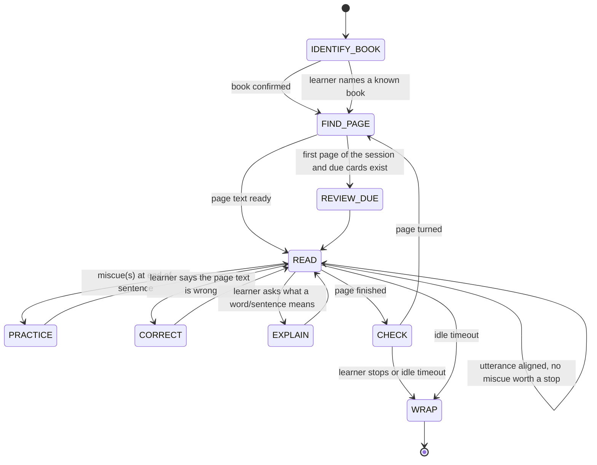

# Flow: a reading session

State machine in `leafi/study/session.py`. Every transition is logged; a crash leaves `reading_sessions.ended_at` null and the next start closes it.



## Sequence for one sentence

```mermaid
sequenceDiagram
    participant L as Learner
    participant Lis as Listener (Ear+VAD+ASR or typed)
    participant S as study.session
    participant A as alignment
    participant C as coach
    participant B as Brain (text only)
    participant H as Hub (say → TTS → Mouths, Faces)
    L->>Lis: reads one sentence aloud
    Lis-->>S: Utterance(words, timestamps, conf)
    S->>A: align(expected_words_from_cursor, utterance)
    A-->>S: verdicts + new cursor
    S->>S: store page_read, utterance, miscues
    alt no miscue
        S->>H: say(short encouragement or nothing)
    else miscues present
        S->>C: feedback(page_text_window, miscues, difficulties)
        C->>B: structured request (schema: line, action, words_to_practice)
        B-->>C: {line, action: practice, words: [...]}
        C-->>S: CoachTurn
        S->>H: say(line)  (voice policy; text on Faces)
        loop each word to practice
            S->>H: say(word, slow) — Kokoro
            L->>Lis: repeats
            Lis-->>S: Utterance
            S->>A: align([word], utterance) + pronunciation score
            S->>S: miscue.resolved = verdict == read
        end
    end
```

## Handling a correction (B5)

1. Learner says "the book says X, not Y" (voice or text). The Listener yields the Utterance; `coach.classify_intent` (local rules first, Brain only if ambiguous) returns `correct_page_text(wrong=Y, right=X)`.
2. `corrections.apply(page, span, right)` writes a `corrections` row, rewrites `pages.text_truth`, rebuilds the page's Lexicon rows.
3. The session re-aligns the current sentence against the new Page text; a Miscue that was caused by the OCR error is deleted (it was never the learner's).
4. Leafi thanks the learner in the Coach voice and continues.

## Handling "I don't understand" (B6)

1. Intent `explain(target)` where `target` is a word, a phrase or "this sentence" (resolved to the current sentence).
2. `coach.explain` asks the Brain for `{meaning_en, meaning_zh, example, follow_up_question}` with the sentence and the two surrounding sentences as context.
3. A `knowledge_items` row is upserted (`kind=word|phrase`, `status=new`); the explanation is spoken and shown.

## Comprehension check (B7)

At `CHECK`, `coach.questions(page_text, knowledge_items_on_page)` asks the Brain for at most two questions with expected-answer keywords; answers are judged by the Brain with the keywords, never by exact match. A missed answer upserts a `knowledge_items` row of kind `fact` or `phrase`.

## Wrap (B8, B9)

1. Summarise: pages read, accuracy, words practised, items learned → `reading_sessions.summary`; notify the parent (text, no audio, optional one frame).
2. Push new/updated Knowledge items to Anki (`study/anki.py`), record `anki_note_id`.
3. Rebuild Difficulties and Lexicon.
