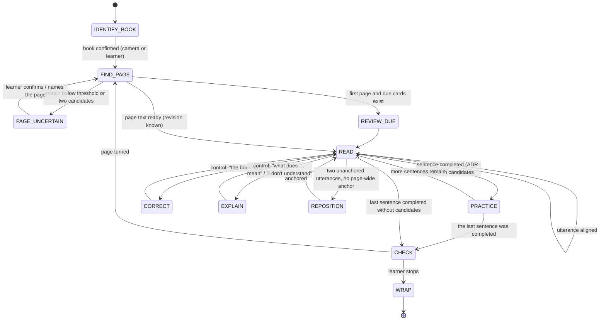

# Flow: a reading session

State machine in `leafi/study/session.py`. Every transition is logged; a crash leaves `reading_sessions.ended_at` null and the next start closes it (open candidates → `unsure (interrupted)`; a new session may offer to continue from the committed cursor). **The reading rules (alignment, commitment, sentence completion, practice, reposition, difficulties, CHECK outcomes) are owned by ADR-0013; this file draws them and adds nothing.** Page identity and revisions: ADR-0010.

## States



Additional state: `LISTENER_LOST` (selected Ear gone; continue in text mode when the console exists). Input routing by state, controls, `/back N`, reposition and completion events: ADR-0013.

**Global transitions (every state except WRAP)** — precedence and the records each one writes are defined in ADR-0013 → Control precedence:
- `stop` (spoken while listening; typed `/stop` or a Face key at any time, including during playback, which cancels the current `say()` first) → completes the current sentence as read, open candidates → `unsure(skipped)` → WRAP.
- `skip` → PRACTICE: current candidate `unsure(skipped)`; READ: completes the sentence as read and moves to the next; CHECK/EXPLAIN/REVIEW_DUE: leaves with no record. Bumps `turn_id`.
- `/back N` → reopens N sentences (ADR-0013 → `/back N`).
- `page turned` (Eye frame-diff settles on a new page, `/page N`, spoken "next page") → completes the current sentence as read, open candidates → `unsure(skipped)`, no practice → FIND_PAGE.
- `idle timeout` (`STUDY_IDLE_S`, default 180) → WRAP with `summary.idle=true`.
- `page uncertain` (camera lost, OCR failed, or a frame-diff without a confident match) → PAGE_UNCERTAIN; assessment is suspended; utterances are still stored with `kind=reading` but produce no observations until the page is confirmed.

## Sequence for one sentence

```mermaid
sequenceDiagram
    participant L as Learner
    participant Lis as Listener (Ear+VAD+ASR or typed)
    participant S as study.session
    participant A as alignment
    participant C as coach (local rules + static phrases)
    participant B as Brain (text only, off the fast path)
    participant H as Hub (say → Faces, TTS → Mouths)
    L->>Lis: reads
    Lis-->>S: Utterance(words, times, conf|None, audio_ref|None)
    S->>A: align(reading_state, utterance)
    A-->>S: (state', observations, events: sentence_reached | unanchored)
    S->>S: store utterance, observations, state'; new candidates; withdrawn candidates (self_corrected / reread)
    Note over S: sentence completion = sentence_reached, or pause 1.2 s / typed line end near the sentence end (ADR-0013)
    alt sentence completed and no candidates
        S->>H: say(local encouragement or nothing)
    else sentence completed with candidates
        S->>C: practice_plan(candidates, difficulties)   — local, ≤ 50 ms
        C-->>S: words_to_practice (max 2), line from static phrases
        S->>H: say(line)
        loop each word (≤ 2 retries, skip always offered)
            S->>H: say(word, slow)
            L->>Lis: repeats
            Lis-->>S: Utterance
            S->>A: align([word], utterance)
            opt PRON_AUTO_JUDGE and audio_ref
                S->>S: pronunciation.score → evidence=acoustic
            end
            S->>S: practices row; a matching retry → withdrawn(practice); two disagreements / skip / idle → unsure; confirmed only with acoustic evidence (voice and text alike, ADR-0013 → Practice)
        end
    end
    opt Brain enrichment (async, turn-guarded)
        S->>B: explanation / question request (redacted page window, target, intent enum)
        B-->>S: result or unavailable
        S->>S: apply only if (session, page_revision, turn_id) unchanged
    end
```

The Brain is never on the path between the end of an utterance and the first spoken feedback (performance.md). Static phrases in the Coach voice cover every coach action; the Brain adds explanations, questions and better lines when it answers in time.

## Handling a correction (B5)

1. Utterance classified as `correction` (grammar: "the book says X not Y" / "it's X not Y" / typed `/fix Y X`); ambiguous cases ask once ("Do you mean the word is X?").
2. Locate `old_text` in the current revision near the cursor (nearest occurrence within the reread window); if not found, ask the learner to point at the line (read it) and retry once; else give up politely and record a `corrections` row with `char_start=null` for the parent.
3. One transaction (ADR-0010 §3, §6): correction row; new revision with the span verified and the edit map; `spans_verified` and the reading state transformed (ADR-0013 → Correction interaction); miscues of any revision whose mapped char span overlaps → `invalidated (page_text_corrected)`; Difficulties recomputed; lexicon update.
4. The reading state now points at the new revision; the learner continues from the committed cursor; Leafi thanks them in the Coach voice.

## Handling "I don't understand" (B6)

1. Intent `explain(target)`; target = the word named, or the current sentence.
2. Immediate local response: Leafi shows/says the sentence and says it will explain. Brain request (redacted window ≤ 3 sentences, target, language order from the profile) → `{meaning_en, meaning_zh?, example, follow_up?}` validated against a strict schema and an allow-list of actions; `unavailable` → Leafi says it cannot explain this one now and moves on, recording the encounter with `explanation_en=null`.
3. `knowledge_items` upsert + `encounters` row.

## Comprehension check (B7)

At `CHECK`: the Brain generates ≤ 2 questions, each with acceptable answers as keyword sets, from the completed sentences; Brain `unavailable` → skip CHECK silently. **The learner's answer stays local** (ADR-0011). Outcomes `correct` / `incorrect` / `unavailable` exactly as defined in ADR-0013 → CHECK outcomes; Leafi gives the answer in the Coach voice regardless; only `incorrect` writes an `encounters` row (`trigger=check`), never a miscue. Page text is data: a page containing instructions ("ignore the previous…") is quoted inside a delimited block and the response is validated against the schema; `tests/test_prompt_injection.py` holds fixed scenarios.

## Wrap (B8, B9)

1. `summary` = counts (pages, tokens committed, candidates/confirmed/withdrawn, items learned, practices); parent notification text-only.
2. `anki_outbox` processed: dedupe by `leafi-id::<key>` tag, add/update, ack; failures stay `pending`.
3. Difficulties and lexicon rebuilt; session `ended_at` set; speech lease released.
