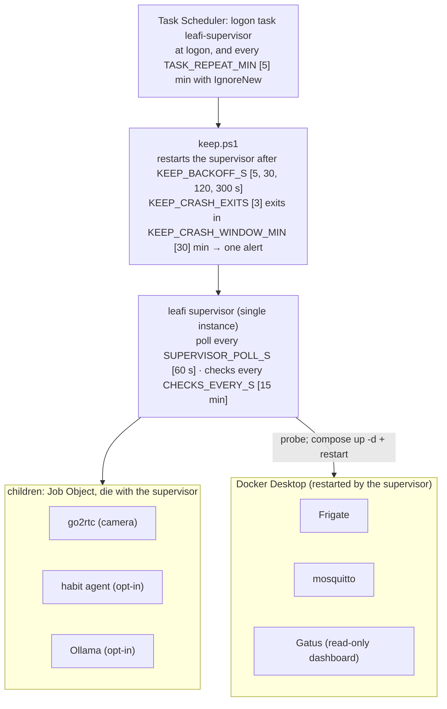
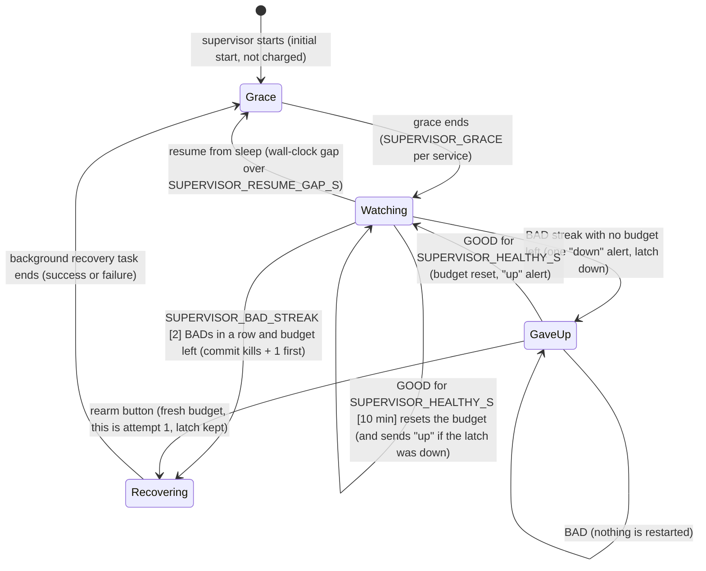
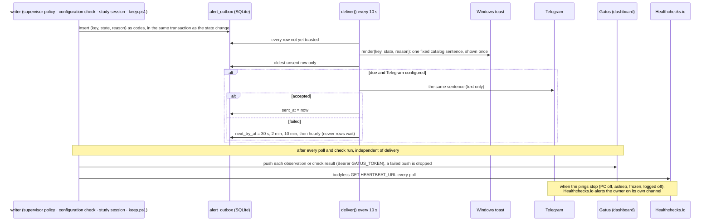

# Flow: how Leafi keeps its services running and tells the owner

ADR-0016 owns every rule drawn here; this page only illustrates it. Numbers are settings (`SUPERVISOR_*`, `CHECKS_EVERY_S`, `KEEP_*`, `TASK_REPEAT_MIN`) with their defaults in brackets; the ADR's "Timing settings and their invariants" says which combinations are valid.

## Who keeps whom running

Docker's own `restart: unless-stopped` restarts a container that exits; the supervisor recovers one that runs but does not answer. Containers are not probed while Docker is down, so one Docker outage is one alert.

## One service's policy

- While **Recovering**, the service is reported RECOVERING and not observed, so no second recovery starts; other services and the heartbeat carry on (the recovery is a background task).
- **IDLE** (nothing wants the camera stream, or Docker is down for a container) clears both the BAD streak and the GOOD run.
- The budget and the latch are in `service_state`, so they survive a supervisor restart. One outage sends one "down" row whatever the button does.

## From a fault to the owner

- Writers pass codes only; `render()` turns them into sentences from `leafi/core/alerts.py`, so no device name, exception text or learner data reaches Telegram (egress table, `tests/test_privacy.py`).
- Configuration checks never repair anything; each has its own latch: one alert when a setting drifts, one when it passes again.
- Gatus has no alerting provider; it shows history only. The outbox is the record.
